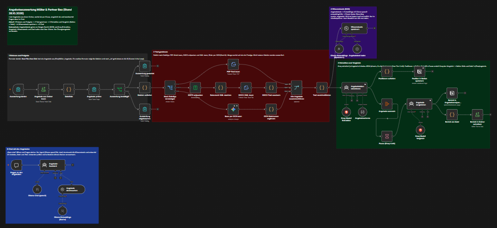
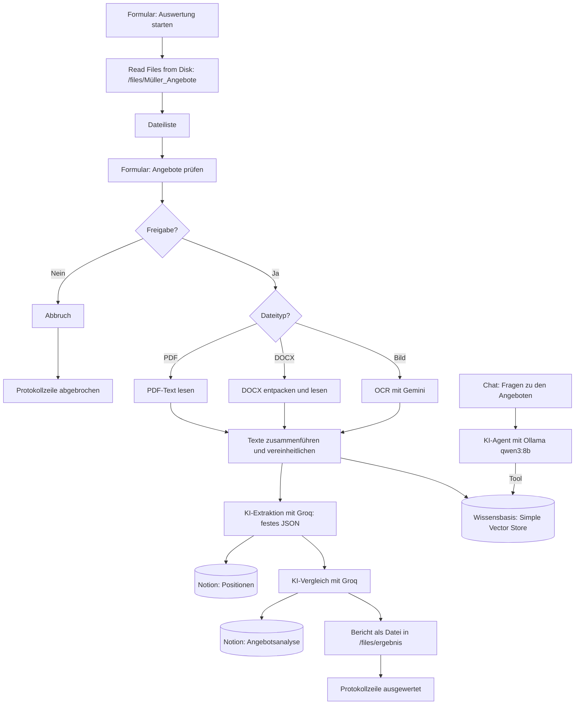

# Angebotsauswertung mit n8n und KI für ein Bauunternehmen

Projekt aus der Weiterbildung „KI-Integrationsmanager:in (IHK)“ am Smart Future Campus. Kunde ist die fiktive Müller & Partner Bau GmbH aus einer Kursaufgabe. Alle Testdaten sind fiktiv.

**Inhalt:** [1 Kurzbeschreibung](#1-kurzbeschreibung) / [2 Ziel und Nutzen](#2-ziel-und-nutzen) / [3 Erweiterung](#3-beschreibung-der-erweiterung) / [4 Ablauf](#4-ablauf-des-workflows) / [5 Tools und KI-Modelle](#5-tools-und-ki-modelle) / [6 Daten](#6-daten) / [7 Integration](#7-integration-im-unternehmen) / [8 Governance und Compliance](#8-governance-und-compliance) / [9 Risiken](#9-risiken-und-gegenmaßnahmen) / [10 Menschliche Kontrolle](#10-menschliche-kontrolle) / [11 Test](#11-test-und-erfolgsmessung) / [12 Installation](#12-installation-und-nutzung) / [13 Lernerfahrungen](#13-lernerfahrungen)

## 1. Kurzbeschreibung

Ein Bauunternehmen bekommt pro Projekt 5 bis 15 Angebote von Subunternehmern: als PDF, Word-Datei, Scan oder Handyfoto, jedes anders aufgebaut. Bisher werden sie von Hand abgetippt und verglichen.

Der Workflow liest alle Angebote aus einem Ordner, erkennt den Text (auch bei Scans), bringt Anbieter, Positionen und Preise per KI in ein einheitliches Format und erstellt einen Vergleich mit Empfehlung je Gewerk. Die Ergebnisse landen in Notion und als Datei im Ordner. Zusätzlich kann man in einem Chat Fragen zu den Angeboten stellen, zum Beispiel: „Welche Sanitär-Angebote schließen Fliesenarbeiten aus?“ Jeder Lauf wird protokolliert.

## 2. Ziel und Nutzen

| Ziel | Wie der Workflow es erreicht |
|---|---|
| **Zeit** | Ein Lauf über 15 Angebote dauert etwa 4 bis 5 Minuten ohne Handarbeit. Von Hand rechnen wir mit etwa 10 bis 15 Minuten je Angebot zum Erfassen und Vergleichen (Annahme, im Pilot zu messen). |
| **Qualität** | Alle Angebote landen im selben Schema. Gleiche Leistungen werden nebeneinander gestellt, Ausschlüsse und Zusatzkosten fallen nicht mehr unter den Tisch. |
| **Fehlerquote** | Keine Abtippfehler. Unklare Preise werden als leer (`null`) markiert statt geraten. Nicht lesbare Dateien nennt der Bericht ausdrücklich. |
| **Nachvollziehbarkeit** | Bericht als Datei, Positionen in Notion, Protokoll jedes Laufs. Chat-Antworten enthalten Anbieter, Datei und Zitat. |
| **Kosten** | Kostenlose Zugänge (Groq, Gemini) und lokale Modelle (Ollama). Im Echtbetrieb fallen Kosten für bezahlte KI-Zugänge oder Hardware an (siehe Punkt 7). |

Der Workflow entscheidet nicht über die Vergabe. Er bereitet die Entscheidung vor, entscheiden muss der Einkauf.

## 3. Beschreibung der Erweiterung

Der Workflow ist in mehreren Stufen gewachsen. Jede Stufe löst ein Problem der vorherigen:

| Stufe | Erweiterung | Warum |
|---|---|---|
| 1 | Upload-Formular, Texterkennung, KI-Extraktion, Vergleich, Notion | Grundfunktion der Kundenanfrage |
| 2 | **Menschliche Freigabe:** Prüfformular vor jeder Übertragung an KI-Dienste | Nichts geht ohne Bestätigung an externe Dienste |
| 3 | **Weitere Datenquelle:** Angebote aus einem Ordner lesen (Read/Write Files from Disk), Bericht zusätzlich als Datei | Der Kunde wollte einen Upload-Ordner statt eines Formulars |
| 4 | **Fehlerbehandlung und Fallback:** Wiederholung bei OCR-Ausfall, Weiterlaufen ohne nicht lesbare Datei, Staffelung wegen Groq-Limit | Gemini war zeitweise überlastet, Groq hat bei zu vielen Anfragen abgebrochen |
| 5 | **KI-Modell eingebunden (RAG):** lokale Wissensbasis und Chat mit Ollama | Schnelle Antworten auf Einzelfragen, ohne den ganzen Bericht zu lesen |
| 6 | **Protokollierung** (neu): eine Zeile je Lauf in `protokoll.csv` | Nachvollziehbarkeit für Governance, Audit und EU AI Act |

**Neueste Erweiterung: Protokollierung.** Jeder Lauf schreibt eine Zeile in `/files/ergebnis/protokoll.csv`, auch wenn die Auswertung mit „Nein“ abgebrochen wird:

| Spalte | Inhalt |
|---|---|
| zeitpunkt | Datum und Uhrzeit |
| ergebnis | ausgewertet / abgebrochen |
| dateien_gesamt, ausgewertet, nicht_gelesen | Wie viele Dateien gefunden und ausgewertet wurden, welche nicht lesbar waren |
| freigabe | Ja / Nein aus dem Prüfformular |
| bemerkung | Freitext aus dem Startformular |
| bericht_datei | Pfad des erzeugten Berichts |
| ki_modelle | Welche Modelle an diesem Lauf beteiligt waren |

Personendaten wie Name oder Benutzerkennung stehen bewusst nicht im Protokoll (Datenminimierung, siehe Punkt 8).

## 4. Ablauf des Workflows





**Schritt für Schritt** (die Nummern entsprechen den farbigen Notizen im Workflow):

1. **Einlesen und Freigabe:** Ein Formular startet den Lauf. Der Node „Read/Write Files from Disk“ liest alle PDF-, DOCX- und Bilddateien aus `/files/Müller_Angebote`. Ein zweites Formular zeigt die gefundenen Dateien. Bei „Nein“ wird nichts gesendet, nur protokolliert.
2. **Text gewinnen:** Ein Switch verteilt die Dateien nach Typ. PDF wird direkt gelesen, DOCX als ZIP entpackt und das XML gelesen, Bilder liest Gemini per OCR. Dateien ohne lesbaren Text werden aussortiert und im Bericht genannt.
3. **Extraktion, Vergleich, Protokoll:** Groq bringt jedes Angebot in dasselbe JSON-Schema (Anbieter, Datum, Projekt, Positionen, Preise, Hinweise). Die Positionen gehen nach Notion. Ein zweiter KI-Schritt erstellt den Vergleich mit Empfehlung je Gewerk. Der Bericht landet auf einer Notion-Seite und als Markdown-Datei im Ordner. Zum Schluss wird die Protokollzeile geschrieben.
4. **Wissensbasis (RAG):** Parallel werden die Angebotstexte mit einem lokalen Embedding-Modell in Vektoren umgewandelt und im Simple Vector Store gespeichert.
5. **Chat:** Über „Open chat“ stellt man Fragen. Ein KI-Agent durchsucht die Wissensbasis und antwortet mit Anbieter, Datei und wörtlichem Zitat.

## 5. Tools und KI-Modelle

| Tool / Modell | Aufgabe | Begründung |
|---|---|---|
| **n8n** (selbst betrieben in Docker) | Workflow-Plattform | Läuft im eigenen Haus, kann lokale Ordner lesen, viele fertige Nodes. Für den internen Einsatz nutzbar unter der Sustainable Use License (für den konkreten Einsatz prüfen). |
| **Read/Write Files from Disk** | Ordner lesen, Bericht und Protokoll schreiben | Anbindung an Netzlaufwerke und Systeme ohne Schnittstelle |
| **Google Gemini `gemini-3.5-flash`** | Texterkennung (OCR) bei Scans und Fotos | Liest auch schiefe Fotos. Im Test waren andere Gemini-Modelle überlastet oder nicht mehr verfügbar. |
| **Groq `openai/gpt-oss-120b`** | Extraktion und Vergleich | Großes Modell mit gutem Deutsch und sauberer JSON-Ausgabe, sehr schnell, kostenloser Einstieg |
| **Ollama `qwen3-embedding:0.6b`** (lokal) | Embeddings für die Wissensbasis | Klein und schnell, läuft auf normaler Hardware, Daten bleiben im Haus |
| **Ollama `qwen3:8b`** (lokal) | Chatmodell im RAG-Chat | Im Test deutlich genauer als `llama3.2:3b` (siehe Punkt 11), läuft lokal |
| **Simple Vector Store** | Wissensbasis | Ohne Einrichtung nutzbar, gut für Lernen und Pilot. Für den Dauerbetrieb Supabase (siehe Punkt 7). |
| **Notion** | Positionen und Bericht für das Team | Bereits im Einsatz, gut lesbar, teilbar |

## 6. Daten

| Daten | Herkunft | Personenbezug / Vertraulichkeit |
|---|---|---|
| Angebote (PDF, DOCX, Bilder) | Subunternehmer | **Vertraulich** (Preise, Konditionen). **Personenbezug möglich:** Ansprechpartner, Unterschriften, Kontaktdaten, bei Einzelunternehmern auch der Firmenname. |
| Extrahierte Angebotsdaten | KI-Extraktion | Geschäftsdaten. Kontaktdaten werden nicht extrahiert. |
| Vergleichsbericht | KI-Vergleich | Vertraulich, intern |
| Wissensbasis (Vektoren) | Angebotstexte | wie die Angebote, nur im Arbeitsspeicher, lokal |
| Protokoll | Workflow | Keine Personendaten, nur Kennzahlen je Lauf |

**Wohin die Daten gehen:** Die Angebotstexte gehen an Google (OCR) und Groq (Extraktion, Vergleich), also an Dienste außerhalb des Unternehmens. Wissensbasis, Chat und Protokoll bleiben lokal. Getestet wurde nur mit fiktiven Übungsangeboten.

## 7. Integration im Unternehmen

**Technische Voraussetzungen**
- Server oder PC mit Docker für n8n, regelmäßige Sicherung des Daten-Volumes
- Gemeinsamer Ordner für den Eingang (`Müller_Angebote`) und die Ergebnisse (`ergebnis`), Zugriff nur für den Einkauf
- Ollama auf derselben Maschine, für flüssige Antworten möglichst mit Grafikkarte
- Bezahlte KI-Zugänge mit Auftragsverarbeitungsvertrag statt Free Tier (Groq-Limit im Free Tier: 8.000 Tokens pro Minute, ein Lauf dauert dadurch etwa 4 Minuten)
- Für den Dauerbetrieb eine echte Vektor-Datenbank (z. B. Supabase) statt Simple Vector Store

**Organisatorische Voraussetzungen**
- Abstimmung mit dem Betriebsrat, gegebenenfalls Betriebsvereinbarung (siehe Punkt 8)
- Schulung der Nutzer im Einkauf: was der Workflow kann, wo er Fehler macht, wie man prüft (KI-Kompetenz)
- Kurze Arbeitsanweisung: Angebote ablegen, Lauf starten, Ergebnis prüfen

**Rollen**

| Rolle | Aufgabe |
|---|---|
| **Fachverantwortung: Leitung Einkauf** | Entscheidet über Einsatz und Vergabe, gibt Läufe frei, prüft Ergebnisse |
| **Betrieb: IT** | n8n, Docker, Ollama, Updates, Sicherung, Zugangsdaten |
| **Wartung: KI-Verantwortliche/r** | Prompts, Modelle, Schema, Tests nach Änderungen, Auswertung des Protokolls |
| **Datenschutzbeauftragte/r** | Prüft Verarbeitung, Verträge mit KI-Anbietern, Verzeichnis der Verarbeitungstätigkeiten |
| **Betriebsrat** | Mitbestimmung bei Einführung und Änderungen |

## 8. Governance und Compliance

| Bereich | Anforderung | Umsetzung im Workflow / im Unternehmen |
|---|---|---|
| **Datenschutz (DSGVO)** | Rechtsgrundlage, Datenminimierung, Auftragsverarbeitung, Drittlandtransfer | Nur Geschäftsdaten werden extrahiert, keine Kontaktdaten. Protokoll ohne Personendaten. Für Gemini und Groq vor dem Echtbetrieb: Auftragsverarbeitungsvertrag (Art. 28 DSGVO), Prüfung des Datentransfers in die USA und der Free-Tier-Bedingungen zur Nutzung von Daten für Training. Alternative: alles lokal über Ollama. |
| **Informationssicherheit** | Zugriffsschutz, Geheimnisse, Sicherung | n8n nur mit Anmeldung, Formulare nur intern erreichbar. API-Schlüssel nur im verschlüsselten Credential-Speicher von n8n, nie im Repository. Dateizugriff auf `/files` beschränkt (`N8N_RESTRICT_FILE_ACCESS_TO`). Backup des n8n-Daten-Volumes. |
| **EU AI Act** | Risikoklasse, KI-Kompetenz, Transparenz | Entscheidungsunterstützung im Einkauf gehört nicht zu den Hochrisiko-Bereichen nach Anhang III. Die Pflicht zur KI-Kompetenz der Nutzer (Art. 4) gilt seit 2. Februar 2025 → Schulung. Die Transparenzpflichten nach Art. 50 gelten ab 2. August 2026 → der Chat ist klar als KI-Assistent bezeichnet. Protokoll und Zitatpflicht sorgen für Nachvollziehbarkeit. |
| **Urheberrecht und Nutzungsrechte** | Rechte an Eingaben und Modellen | Angebote werden nur intern zur Auswertung genutzt. Lizenzen: Qwen3 unter Apache 2.0, n8n unter Sustainable Use License, Nutzungsbedingungen von Google und Groq für die API (für den konkreten Einsatz prüfen). KI-Ergebnisse sind Arbeitshilfen. |
| **Mitbestimmung (BetrVG)** | § 87 Abs. 1 Nr. 6 BetrVG | Es reicht schon, dass ein System objektiv geeignet ist, Verhalten oder Leistung zu überwachen. Deshalb protokolliert der Workflow keine Personen. Die Einführung wird trotzdem mit dem Betriebsrat abgestimmt. |
| **Interne Richtlinien** | KI-Richtlinie, Freigabeprozess | Nur freigegebene KI-Dienste verwenden. Vergabeentscheidung bleibt beim Menschen. Änderungen an Prompts und Modellen nur nach Test (Punkt 11). |

Quellen zu EU AI Act und BetrVG: [FORUM Institut: Änderungen EU AI Act August 2026](https://forum-institut.de/fileadmin/Bilder/B2/Content/Aenderung-EU-AI-Act-August-2026.pdf), [IHK Bonn: KI-Kompetenz](https://ihk-bonn.de/recht-und-steuern/recht/aktuelles/unternehmen-muessen-fuer-ki-kompetenz-ihrer-beschaeftigten-sorgen), [CMS: KI-Transformation und Betriebsrat](https://cms.law/de/deu/legal-updates/ki-transformation-und-betriebsrat-mitbestimmung-richtig-gestalten). Keine Rechtsberatung.

## 9. Risiken und Gegenmaßnahmen

| Risiko | Art | Gegenmaßnahme |
|---|---|---|
| KI erfindet oder verwechselt Angaben | technisch | Festes JSON-Schema, „nichts erfinden, sonst null“, Zitatpflicht im Chat, größeres Modell, menschliche Prüfung |
| OCR fällt aus oder liest unvollständig | technisch | Wiederholung, Weiterlaufen ohne Datei, Bericht nennt nicht gelesene Dateien |
| Rate Limit oder Ausfall des KI-Dienstes | technisch | Staffelung, Pause, Wiederholung. Im Echtbetrieb bezahlter Zugang oder Fallback auf lokales Modell |
| Vertrauliche Angebote gehen an Dritte | rechtlich | Freigabeformular, Auftragsverarbeitungsverträge, Alternative komplett lokal |
| Wissensbasis nach Neustart leer | technisch | Bei jedem Lauf neu befüllt. Dauerbetrieb mit Supabase. |
| Leistungskontrolle von Mitarbeitenden | rechtlich, organisatorisch | Keine Personendaten im Protokoll, Abstimmung mit dem Betriebsrat |
| Blindes Vertrauen in die Empfehlung | organisatorisch | Schulung, Empfehlung immer mit Begründung, Entscheidung beim Einkauf |
| Zugangsdaten im Repository | Sicherheit | Exporte werden vor dem Hochladen bereinigt, Platzhalter statt IDs |

## 10. Menschliche Kontrolle

| Zeitpunkt | Wer | Was |
|---|---|---|
| Vor der Auswertung | Einkauf | Prüfformular: Stimmen die Dateien? Erst nach „Ja“ werden Daten gesendet. |
| Nach der Auswertung | Einkauf | Bericht prüfen, besonders Angebote mit fehlenden Angaben und nicht gelesene Dateien |
| Vergabe | Leitung Einkauf | Entscheidung über den Auftrag. Der Workflow gibt nur eine Empfehlung. |
| Chat-Antworten | Nutzer | Zitat mit dem Originalangebot abgleichen, bevor die Antwort weiterverwendet wird |
| Änderungen am Workflow | KI-Verantwortliche/r | Neue Prompts oder Modelle erst nach Test (Punkt 11) freigeben |

## 11. Test und Erfolgsmessung

Alle Tests mit 15 fiktiven Angeboten (10 PDF, 3 DOCX, 1 Scan, 1 Foto). Die ausführlichen Ergebnisse mit Beispielen stehen in **[TESTS.md](TESTS.md)**.

| Test | Ergebnis |
|---|---|
| Ordner lesen | 15 von 15 Dateien gefunden |
| Text gewinnen | 13 von 13 PDF und DOCX gelesen, OCR abhängig von der Verfügbarkeit von Gemini |
| OCR-Ausfall | Lauf läuft weiter, Bericht nennt die nicht gelesene Datei |
| Vollständiger Lauf | Positionen in Notion, Bericht in Notion und als Datei, etwa 4 bis 5 Minuten |
| RAG-Chat | Mit `qwen3:8b` und Zitatpflicht 3 von 3 Testfragen richtig, mit `llama3.2:3b` vorher nur teilweise |
| Protokoll | Eine Zeile bei „Ja“ und bei „Nein“ |

**Woran man Zuverlässigkeit und Nutzen erkennt (Kennzahlen für den Pilot):**
- Anteil vollständig ausgewerteter Dateien je Lauf (aus dem Protokoll)
- Anteil der Läufe ohne Fehler (aus den n8n-Ausführungen)
- Stichprobe: Abweichungen zwischen KI-Extraktion und Originalangebot (Ziel: keine bei Gesamtpreisen)
- Durchlaufzeit je Projekt im Vergleich zur Handauswertung
- Rückmeldung des Einkaufs zur Nutzbarkeit des Berichts

## 12. Installation und Nutzung

**Voraussetzungen:** Docker, n8n, Ollama, Zugänge zu Groq, Google Gemini und Notion. Im Repository stehen keine echten Zugangsdaten. Notion-IDs sind durch `HIER-NOTION-ID-EINTRAGEN` ersetzt.

1. **n8n mit Ordner starten:**
   ```
   docker run -d --name n8n_files -p 5678:5678 -e N8N_RESTRICT_FILE_ACCESS_TO="/files" -v n8n_data:/home/node/.n8n -v "C:\Pfad\zu\files:/files" n8nio/n8n:latest
   ```
2. **Ordner anlegen:** `files/Müller_Angebote` für die Angebote, `files/ergebnis` für Berichte und Protokoll. In `ergebnis` eine Datei `protokoll.csv` mit dieser Kopfzeile anlegen:
   ```
   zeitpunkt;ergebnis;dateien_gesamt;ausgewertet;nicht_gelesen;freigabe;bemerkung;bericht_datei;ki_modelle
   ```
3. **Ollama installieren und Modelle laden:**
   ```
   ollama pull qwen3-embedding:0.6b
   ollama pull qwen3:8b
   ```
4. **Workflow importieren:** In n8n „Import from File“ und `workflow.json` wählen.
5. **Zugangsdaten anlegen und zuordnen:** Groq (beide Groq-Nodes), Google Gemini („Scan per OCR lesen“), Notion (beide Notion-Nodes), Ollama mit Base URL `http://host.docker.internal:11434` (drei Ollama-Nodes).
6. **Notion vorbereiten:** Datenbank „Angebotszusammenfassung“ (Felder Projekt, Datum, Gesamtpreis, Hinweise, Position) und Seite „Angebotsanalyse“ anlegen, für die Integration freigeben, IDs in die Notion-Nodes eintragen.
7. **Nutzen:** Angebote in den Ordner legen. Formular „Auswertung starten“ öffnen, Dateien prüfen, „Ja“ wählen. Nach etwa 4 bis 5 Minuten liegen Bericht und Protokoll im Ordner `ergebnis`, Positionen und Bericht in Notion.
8. **Chat:** Beim Node „Fragen zu den Angeboten“ auf „Open chat“ klicken. Nach einem Neustart von n8n vorher einmal eine Auswertung laufen lassen, damit die Wissensbasis gefüllt ist.

## 13. Lernerfahrungen

- KI ist stark beim Verstehen unstrukturierter Texte. Format, Prüfung, Speicherung und Protokoll gehören in den Workflow, nicht in die KI.
- Kostenlose KI-Zugänge haben Grenzen bei Tempo und Verfügbarkeit. Fehlerbehandlung ist kein Extra, sondern Pflicht.
- Bei RAG entscheidet auch das Sprachmodell über die Qualität. Zitatpflicht macht Fehler sichtbar.
- Datenschutz und Mitbestimmung lassen sich schon im Design berücksichtigen: Freigabe vor dem Senden, lokale Modelle, Protokoll ohne Personendaten.
- Ein Workflow wächst am besten in kleinen, getesteten Schritten. Die Versionsgeschichte in n8n zeigt jede Stufe.
