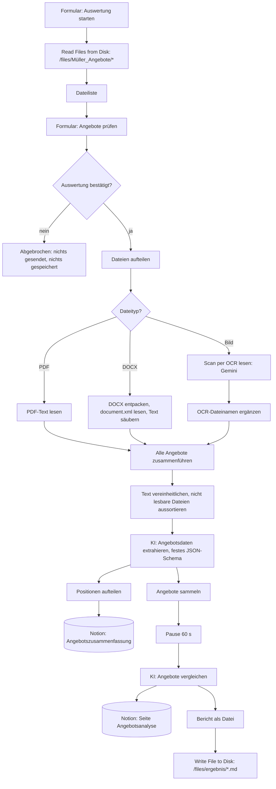

# Automatisierte Angebotsauswertung für ein Bauunternehmen (n8n + KI)

Ein n8n-Workflow, der Angebote von Subunternehmern direkt aus einem Ordner auf der Festplatte liest (PDF, Word, Scan oder Foto), die Inhalte per KI extrahiert, jede Position in einer Notion-Datenbank speichert und einen begründeten Angebotsvergleich erstellt. Der Bericht landet auf einer Notion-Seite und zusätzlich als Datei wieder im Ordner.

Entstanden im Rahmen der Weiterbildung „KI-Integrationsmanager:in (IHK)“ am Smart Future Campus. Kunde ist die fiktive Müller & Partner Bau GmbH aus einer Kursaufgabe.

## Projektziel

Ein mittelständisches Bauunternehmen erhält pro Projekt 5 bis 15 Angebote von Subunternehmern und wertet sie bisher von Hand aus. Die Angebote sind unterschiedlich aufgebaut: mal als Tabelle, mal als Fließtext, teils eingescannt oder fotografiert. Gewünscht ist ein Upload-Ordner, aus dem die Angebote ohne manuelle Zwischenschritte ausgewertet werden:

1. Angebote automatisch aus einem Ordner einlesen (PDF, DOCX, Bild)
2. Relevante Inhalte extrahieren (Anbieter, Datum, Projekt, Positionen, Preise, Hinweise)
3. Alles in ein einheitliches, vergleichbares Format bringen
4. Angebote vergleichen und eine begründete Empfehlung geben
5. Ergebnisse strukturiert speichern und einen Bericht erzeugen

## Verwendete Tools

- n8n mit Docker, Ordner als Volume eingebunden (`/files`)
- n8n-Nodes: Read/Write Files from Disk, Form Trigger, Form, If, Switch, Extract from File, Compression, Merge, Aggregate, Wait, Code
- Groq, Modell `openai/gpt-oss-120b`: Datenextraktion und Angebotsvergleich (KI-Agent mit Structured Output Parser)
- Google Gemini `gemini-3.5-flash`: Texterkennung (OCR) für Scans und Fotos
- Notion: Datenbank „Angebotszusammenfassung“ und Seite „Angebotsanalyse“
- JavaScript im Code-Node

## Workflow

Der Workflow liegt in [`workflow.json`](workflow.json).



**Ablauf Schritt für Schritt**

1. **Start**: Ein n8n-Formular startet die Auswertung.
2. **Ordner lesen**: Der Node „Read/Write Files from Disk“ liest alle Angebote aus `/files/Müller_Angebote/*.{pdf,docx,png,jpg,jpeg,webp}`. Der Ordner liegt auf dem PC und ist per Docker-Volume in n8n eingebunden.
3. **Prüfen (Human in the Loop)**: Ein zweites Formular zeigt die gefundenen Dateien. Erst nach „Ja“ gehen die Angebote an die KI-Dienste und nach Notion.
4. **Text gewinnen**: Ein Switch verteilt die Dateien nach Typ. PDF-Text wird direkt gelesen. DOCX wird als ZIP entpackt und `document.xml` ausgelesen. Bilder liest Gemini per OCR, danach bekommen sie ihren Dateinamen zurück.
5. **Vereinheitlichen**: Ein Merge-Node wartet auf alle drei Zweige. Dateien ohne lesbaren Text werden aussortiert und später im Bericht genannt.
6. **Extraktion**: Ein KI-Agent überführt jedes Angebot in dasselbe JSON-Format: Anbieter, Datum, Projekt, Positionen mit Preis, Gesamtpreis, Hinweise. Preise, die nicht eindeutig sind, werden `null`. Nichts wird erfunden.
7. **Positionen speichern**: Jede Position wird eine Zeile in der Notion-Datenbank.
8. **Vergleich**: Nach einer Pause wegen des Groq-Limits erstellt ein zweiter KI-Agent den Bericht mit Übersicht, vergleichbaren Leistungen, Auffälligkeiten und einer Empfehlung je Gewerk.
9. **Ergebnis**: Der Bericht ersetzt den Inhalt der Notion-Seite „Angebotsanalyse“ und wird als Markdown-Datei nach `/files/ergebnis/` geschrieben. Oben steht, wie viele Dateien ausgewertet wurden und welche nicht gelesen werden konnten.

Der Workflow trifft keine Vergabeentscheidung. Er liefert eine Empfehlung mit Begründung, entscheiden muss der Einkauf.

## Screenshots

Workflow-Ansicht der Vorversion mit Upload-Formular. Der Aufbau ab „Dateien aufteilen“ ist gleich geblieben, den aktuellen Gesamtablauf zeigt das Diagramm oben.


## Herausforderungen

- **Ordnerzugriff aus Docker**: n8n läuft im Container und sieht die Festplatte nicht. Lösung: Ordner als Volume einbinden (`-v "C:\…\files:/files"`) und mit `N8N_RESTRICT_FILE_ACCESS_TO=/files` freigeben. Beim Umzug musste das bestehende Daten-Volume weiterverwendet werden, damit Workflows und Zugangsdaten erhalten bleiben.
- **Unterschiedliche Formate**: Jeder Dateityp braucht einen eigenen Weg zum Text. DOCX ist technisch ein ZIP-Archiv und wird entpackt.
- **Ausfälle der OCR**: Gemini war zeitweise überlastet, ein Modell war nicht mehr verfügbar. Lösung: aktuelles Modell, Wiederholung bei Fehler und Weiterlaufen ohne die betroffene Datei. Der Bericht nennt die nicht gelesenen Dateien.
- **Rate Limit bei Groq**: Der kostenlose Zugang erlaubt 8.000 Tokens pro Minute. Lösung: Angebote einzeln mit 8 Sekunden Abstand extrahieren und vor dem Vergleich 60 Sekunden pausieren. Ein Lauf dauert dadurch etwa 4 Minuten.
- **Strenges JSON-Schema**: Groq lehnte Antworten ab, wenn ein Preis fehlte. Das Schema erlaubt jetzt ausdrücklich `null`.

## Lernerfahrungen

- Mit Read/Write Files from Disk lässt sich n8n an Ordner und Systeme ohne Schnittstelle anbinden. Pfade in n8n sind immer Container-Pfade wie `/files`, nie Windows-Pfade.
- KI ist stark beim Verstehen unstrukturierter Texte. Format, Prüfung und Speicherung gehören in den Workflow.
- Kostenlose KI-Zugänge haben Grenzen bei Tempo und Verfügbarkeit. Für den Echtbetrieb gehören ein bezahlter Zugang oder ein lokales Modell in die Kostenplanung.
- Human in the Loop lässt sich in n8n einfach mit einem Formular und einer If-Abfrage einbauen.

## Einrichtung

1. n8n mit eingebundenem Ordner starten, zum Beispiel:
   ```
   docker run -d --name n8n_files -p 5678:5678 -e N8N_RESTRICT_FILE_ACCESS_TO="/files" -v n8n_data:/home/node/.n8n -v "C:\Pfad\zu\files:/files" n8nio/n8n:latest
   ```
2. Im Ordner `files` die Unterordner `Müller_Angebote` und `ergebnis` anlegen und die Angebote in `Müller_Angebote` legen.
3. In n8n „Import from File“ und `workflow.json` laden.
4. Zugangsdaten hinterlegen: Groq in beiden Groq-Nodes, Google Gemini im Node „Scan per OCR lesen“, Notion in beiden Notion-Nodes.
5. In Notion eine Datenbank „Angebotszusammenfassung“ (Felder: Projekt, Datum, Gesamtpreis, Hinweise, Position) und eine Seite „Angebotsanalyse“ anlegen, für die Integration freigeben und die IDs in den Notion-Nodes eintragen (Platzhalter `HIER-NOTION-ID-EINTRAGEN`).
6. Workflow ausführen, Formular öffnen, „Ordner einlesen“ und danach „Ja“ bestätigen.

Zugangsdaten, Notion-IDs und lokale Pfade sind in der JSON-Datei nicht enthalten.

## Datenschutz

- Die Angebotstexte werden an Google Gemini (Texterkennung) und Groq (Extraktion, Vergleich) übertragen. Für den Echtbetrieb sind ein Auftragsverarbeitungsvertrag oder ein lokal betriebenes Modell zu prüfen.
- Vor der Übertragung bestätigt der Nutzer im Formular, welche Dateien ausgewertet werden.
- Getestet wurde nur mit fiktiven Übungsangeboten ohne echte Personen- oder Firmendaten.
