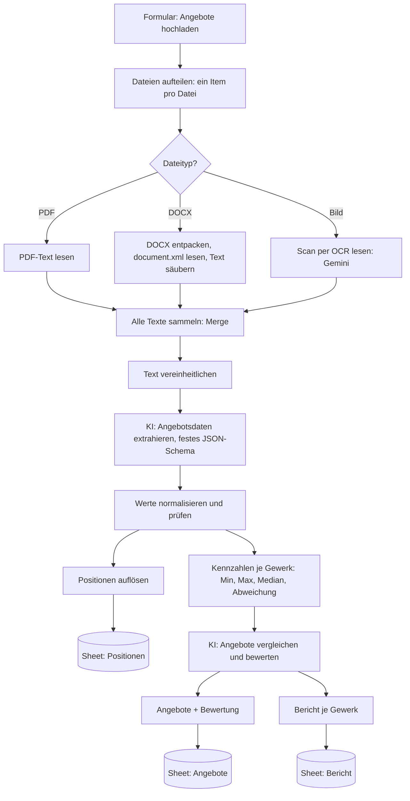

# Automatisierte Angebotsauswertung für ein Bauunternehmen (n8n + KI)

Ein n8n-Workflow, der Angebote von Subunternehmern in unterschiedlichen Formaten (PDF, Word, Scan oder Foto) einliest, die Inhalte per KI in ein einheitliches Format bringt, die Angebote je Gewerk vergleicht und das Ergebnis in Google Sheets ablegt.

Entstanden im Rahmen der Weiterbildung „KI-Integrationsmanager:in (IHK)“ am Smart Future Campus. Kunde ist die fiktive Müller & Partner Bau GmbH aus einer Kursaufgabe.

## Projektziel

Ein mittelständisches Bauunternehmen erhält pro Projekt 5 bis 15 Angebote von Subunternehmern und wertet sie bisher von Hand aus. Die Angebote sind unterschiedlich aufgebaut: mal als Tabelle, mal als Fließtext, teils eingescannt oder fotografiert. Ziel ist eine Auswertung ohne manuelle Zwischenschritte:

1. Angebote automatisch einlesen (PDF, DOCX, Bild)
2. Relevante Inhalte extrahieren (Anbieter, Datum, Projekt, Positionen, Preise, Zeitraum, Ausschlüsse)
3. Alles in ein einheitliches, vergleichbares Format bringen
4. Angebote je Gewerk vergleichen und eine begründete Empfehlung geben
5. Ergebnisse strukturiert speichern und einen Bericht je Gewerk erzeugen

## Verwendete Tools

- n8n (Form Trigger, Switch, Extract from File, Compression, Merge, Code, Google Sheets)
- Google Gemini 2.5 Flash: Texterkennung (OCR) für Scans und Fotos, Datenextraktion, Angebotsvergleich
- n8n-KI-Nodes: Information Extractor, Basic LLM Chain, Structured Output Parser
- Google Sheets als Ergebnisablage
- JavaScript im Code-Node für Prüfungen und Kennzahlen

## Workflow

Der Workflow liegt in [`workflow.json`](workflow.json).

**Ablauf Schritt für Schritt**

1. **Upload**: Über ein n8n-Formular lädt man ein oder mehrere Angebote hoch (PDF, DOCX, PNG, JPG).
2. **Aufteilen und Verzweigen**: Ein Code-Node macht aus dem Upload ein Item pro Datei. Ein Switch leitet jede Datei nach Typ in den passenden Zweig.
3. **Text gewinnen**:
   - PDF: Text direkt mit „Extract from File“
   - DOCX: Die Datei wird entpackt, `document.xml` gelesen und von XML-Tags befreit (ohne Community-Node)
   - Bild: Gemini liest den sichtbaren Text wortgetreu aus (OCR)
4. **Sammeln**: Ein Merge-Node wartet auf alle drei Zweige. Danach laufen alle Angebote gemeinsam weiter, was für den Vergleich nötig ist.
5. **Extraktion (Punkt 2 und 3)**: Der Information Extractor überführt jedes Angebot in dasselbe JSON-Schema: Anbieter, Datum, Projekt, Gewerk, Positionen mit Standard-Kategorie, Summen, Preisart, Zeitraum, enthaltene Leistungen, Ausschlüsse und Risiken. Die Standard-Kategorien machen gleiche Leistungen trotz anderer Formulierung vergleichbar (z. B. „Sicherungskasten“ wird zu „Verteilung/Sicherungstechnik“).
6. **Prüfen**: Ein Code-Node wandelt Beträge in Zahlen um, prüft die Positionssumme gegen die Gesamtsumme und markiert fehlende Angaben. Jedes Angebot bekommt den Status „vollständig“ oder „prüfen“.
7. **Kennzahlen**: Je Projekt und Gewerk berechnet der Code Min, Max, Median und die Abweichung jedes Angebots vom Median. Die KI bekommt fertige Zahlen und muss nicht selbst rechnen.
8. **KI-Vergleich (Punkt 4)**: Die KI bewertet je Gewerk jedes Angebot mit Rang, Einstufung (empfohlen / geeignet / prüfen / abraten), Stärken, Schwächen und Auffälligkeiten und gibt eine begründete Empfehlung. Der günstigste Preis ist dabei nicht automatisch das beste Angebot.
9. **Ergebnis (Punkt 5)**: Drei Tabellenblätter in Google Sheets:
   - **Angebote**: eine Zeile je Angebot mit Daten und Bewertung
   - **Positionen**: eine Zeile je Leistung für den Leistungsvergleich
   - **Bericht**: eine Zeile je Gewerk mit Kennzahlen, Ranking und Empfehlung

**Human in the Loop**: Der Workflow trifft keine Vergabeentscheidung. Er liefert eine Empfehlung mit Begründung, entscheiden muss der Einkauf. Angebote mit Status „prüfen“ oder Einstufung „prüfen“ zeigen, wo eine Rückfrage beim Anbieter nötig ist.

## Dateien im Repository

| Datei / Ordner | Inhalt |
|---|---|
| `workflow.json` | n8n-Workflow zum Import |
| `Angebotsauswertung_Sheet-Vorlage.xlsx` | Vorlage für Google Sheets mit den drei Tabellenblättern und Spaltenköpfen |

Getestet wurde mit 15 fiktiven Angeboten aus dem Kurs (10 PDF, 3 DOCX, 1 Scan, 1 Foto).

## Screenshots

<!-- Screenshots hier per Drag and Drop einfügen, z. B. Workflow in n8n, Upload-Formular, Ergebnis in Google Sheets -->

Screenshots folgen.

## Herausforderungen

- **Unterschiedliche Formate**: Jeder Dateityp braucht einen eigenen Weg zum Text. Für DOCX wurde statt eines Community-Nodes das Entpacken der Datei genutzt, das läuft mit Bordmitteln von n8n.
- **Uneinheitliche Angebote**: Mal Tabelle mit Einzelpreisen, mal „ca. 13.200 Euro“ im Fließtext, mal „nach Aufwand“. Gelöst mit festem JSON-Schema, Feldern für Preisart und Preisbasis und der Regel „fehlt eine Angabe, dann null“.
- **Vergleichbarkeit der Leistungen**: Gleiche Leistungen heißen bei jedem Anbieter anders. Lösung: Standard-Kategorien je Gewerk, der Originaltext bleibt zusätzlich erhalten.
- **Rechenfehler der KI vermeiden**: Summen, Median und Abweichungen rechnet der Code, die KI bewertet nur.
- **Alle Angebote in einem Durchlauf**: Ohne den Merge-Node liefen die drei Zweige getrennt und der Vergleich sah nicht alle Angebote.
- **Limits im Gratis-Tarif von Gemini**: Anfragen werden in kleinen Paketen mit Pausen geschickt.

## Lernerfahrungen

- KI ist stark beim Verstehen unstrukturierter Texte. Prüfen, Rechnen und Speichern sollten im Workflow passieren, damit das Ergebnis nachvollziehbar bleibt.
- Ein sauberes Datenschema ist die halbe Lösung: Es entscheidet, ob ein Vergleich überhaupt möglich ist.
- Datenfluss in n8n verstehen: Items, Binärdaten, Merge und Zugriffe auf frühere Nodes mit `$('Node')`.
- Eine Empfehlung braucht eine Begründung und eine verantwortliche Person, die entscheidet.

## Einrichtung

1. In n8n: „Import from File“ und `workflow.json` laden.
2. Zugangsdaten für Google Gemini (API-Key aus Google AI Studio) in den Nodes „Scan per OCR lesen“, „Gemini Modell“ und „Gemini Modell Vergleich“ hinterlegen.
3. `Angebotsauswertung_Sheet-Vorlage.xlsx` in Google Sheets importieren, Google-Sheets-Zugangsdaten anlegen und in den drei Sheet-Nodes das Dokument auswählen.
4. Workflow ausführen, Formular öffnen und eigene Testangebote hochladen.

Zugangsdaten sind in der JSON-Datei nicht enthalten.

## Datenschutz

- Die Angebotstexte werden zur Texterkennung und Extraktion an Google Gemini übertragen. Für den Echtbetrieb sind deshalb ein Auftragsverarbeitungsvertrag oder ein lokal betriebenes Modell zu prüfen.
- An die Vergleichs-KI gehen nur Geschäftsdaten (Preise, Leistungen, Termine), keine Kontaktdaten.
- Die Beispielangebote sind fiktiv und enthalten keine echten Personen- oder Firmendaten.
