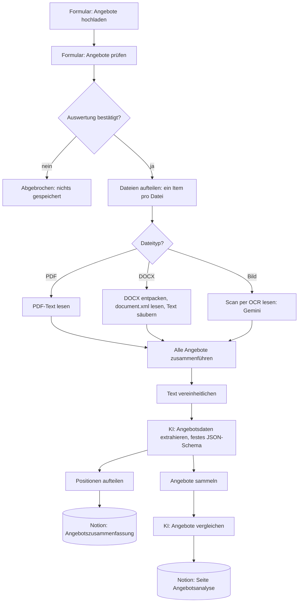

# Automatisierte Angebotsauswertung für ein Bauunternehmen (n8n + KI)

Ein n8n-Workflow, der Angebote von Subunternehmern in unterschiedlichen Formaten (PDF, Word, Scan oder Foto) einliest, die Inhalte per KI extrahiert, jede Position in einer Notion-Datenbank speichert und einen begründeten Angebotsvergleich als Notion-Seite erstellt.

Entstanden im Rahmen der Weiterbildung „KI-Integrationsmanager:in (IHK)“ am Smart Future Campus. Kunde ist die fiktive Müller & Partner Bau GmbH aus einer Kursaufgabe.

## Projektziel

Ein mittelständisches Bauunternehmen erhält pro Projekt 5 bis 15 Angebote von Subunternehmern und wertet sie bisher von Hand aus. Die Angebote sind unterschiedlich aufgebaut: mal als Tabelle, mal als Fließtext, teils eingescannt oder fotografiert. Ziel ist eine Auswertung ohne manuelle Zwischenschritte:

1. Angebote automatisch einlesen (PDF, DOCX, Bild)
2. Relevante Inhalte extrahieren (Anbieter, Datum, Projekt, Positionen, Preise, Hinweise)
3. Alles in ein einheitliches, vergleichbares Format bringen
4. Angebote vergleichen und eine begründete Empfehlung geben
5. Ergebnisse strukturiert speichern und einen Bericht erzeugen

## Verwendete Tools

- n8n (Form Trigger, Form, If, Switch, Extract from File, Compression, Merge, Aggregate, Code)
- Groq, Modell `openai/gpt-oss-120b`: Datenextraktion und Angebotsvergleich (KI-Agent mit Structured Output Parser)
- Google Gemini: Texterkennung (OCR) für Scans und Fotos
- Notion: Datenbank „Angebotszusammenfassung“ und Seite „Angebotsanalyse“
- JavaScript im Code-Node

## Workflow

Der Workflow liegt in [`workflow.json`](workflow.json).

**Ablauf Schritt für Schritt**

1. **Upload**: Über ein n8n-Formular lädt man die Angebote eines Projekts hoch (PDF, DOCX, PNG, JPG).
2. **Prüfen (Human in the Loop)**: Ein zweites Formular zeigt die hochgeladenen Dateien. Erst nach „Ja“ gehen die Angebote an die KI-Dienste und nach Notion. Bei „Nein“ wird nichts ausgewertet und nichts gespeichert.
3. **Aufteilen und Verzweigen**: Ein Code-Node macht aus dem Upload ein Item pro Datei. Ein Switch leitet jede Datei nach Typ in den passenden Zweig.
4. **Text gewinnen**:
   - PDF: Text direkt mit „Extract from File“
   - DOCX: Die Datei wird als ZIP entpackt, `document.xml` gelesen und von XML-Tags befreit (ohne Community-Node)
   - Bild: Gemini liest den sichtbaren Text wortgetreu aus (OCR)
5. **Zusammenführen**: Ein Merge-Node wartet auf alle drei Zweige, danach laufen alle Angebote gemeinsam weiter.
6. **Extraktion**: Ein KI-Agent überführt jedes Angebot in dasselbe JSON-Format: Anbieter, Datum, Projekt, Positionen mit Preis, Gesamtpreis, Hinweise. Regel: Preise nur übernehmen, wenn sie eindeutig sind, sonst `null`. Nichts erfinden.
7. **Positionen speichern**: Jede Position wird eine Zeile in der Notion-Datenbank „Angebotszusammenfassung“. Pauschalangebote ohne Einzelpositionen bekommen eine Sammelzeile.
8. **Vergleich**: Alle Angebote werden gesammelt und an einen zweiten KI-Agenten gegeben. Er erstellt einen Bericht mit Übersichtstabelle, vergleichbaren Leistungen, Zusammenfassung je Angebot, Auffälligkeiten (ungewöhnliche Preise, fehlende Angaben, Ausschlüsse) und einer begründeten Empfehlung. Bei verschiedenen Gewerken empfiehlt er je Gewerk.
9. **Bericht**: Der Bericht ersetzt den Inhalt der Notion-Seite „Angebotsanalyse“, mit Datum und Anzahl der Angebote.

Der Workflow trifft keine Vergabeentscheidung. Er liefert eine Empfehlung mit Begründung, entscheiden muss der Einkauf.

## Screenshots

## Herausforderungen

- **Unterschiedliche Formate**: Jeder Dateityp braucht einen eigenen Weg zum Text. DOCX ist technisch ein ZIP-Archiv. Der Entpack-Node erkennt es aber nur an der Endung `.zip`, deshalb wird die Datei vorher im Code umbenannt.
- **Uneinheitliche Angebote**: Mal Tabelle mit Einzelpreisen, mal „ca. 13.200 Euro“ im Fließtext. Gelöst mit festem JSON-Schema und der Regel „fehlt eine Angabe, dann null“.
- **Alle Angebote in einem Vergleich**: Ohne Merge und Aggregate würde jedes Angebot einzeln verglichen. Erst das Sammeln macht einen echten Vergleich möglich.
- **Vergleichbarkeit der Leistungen**: Gleiche Leistungen heißen bei jedem Anbieter anders. Die Vergleichs-KI stellt gleichartige Positionen nebeneinander.
- **Datenschutz vor dem Senden**: Die Bestätigung vor der Auswertung verhindert, dass versehentlich falsche Dateien an externe KI-Dienste gehen.

## Lernerfahrungen

- KI ist stark beim Verstehen unstrukturierter Texte. Format, Prüfung und Speicherung sollten im Workflow festgelegt sein, damit das Ergebnis nachvollziehbar bleibt.
- Ein sauberes Datenschema ist die Grundlage für jeden Vergleich.
- Datenfluss in n8n verstehen: Items, Binärdaten, Merge, Aggregate und Zugriffe auf frühere Nodes mit `$('Node')`.
- Human in the Loop lässt sich in n8n einfach mit einem Formular und einer If-Abfrage einbauen.

## Einrichtung

1. In n8n: „Import from File“ und `workflow.json` laden.
2. Zugangsdaten hinterlegen: Groq (API-Key von console.groq.com) in beiden Groq-Nodes, Google Gemini (API-Key aus Google AI Studio) im Node „Scan per OCR lesen“.
3. In Notion eine Datenbank „Angebotszusammenfassung“ mit den Feldern Projekt (Text), Datum (Datum), Gesamtpreis (Zahl), Hinweise (Text) und Position (Text) sowie eine Seite „Angebotsanalyse“ anlegen und für die Integration freigeben.
4. In den beiden Notion-Nodes die Notion-Zugangsdaten auswählen und die IDs von Datenbank und Seite eintragen (Platzhalter `HIER-NOTION-ID-EINTRAGEN`).
5. Workflow ausführen und das Formular öffnen.

Zugangsdaten und Notion-IDs sind in der JSON-Datei nicht enthalten.

## Datenschutz

- Die Angebotstexte werden an Google Gemini (Texterkennung) und Groq (Extraktion, Vergleich) übertragen. Für den Echtbetrieb sind deshalb ein Auftragsverarbeitungsvertrag oder ein lokal betriebenes Modell zu prüfen.
- Vor der Übertragung bestätigt der Nutzer im Formular, welche Dateien ausgewertet werden.
- Getestet wurde nur mit fiktiven Übungsangeboten ohne echte Personen- oder Firmendaten.
